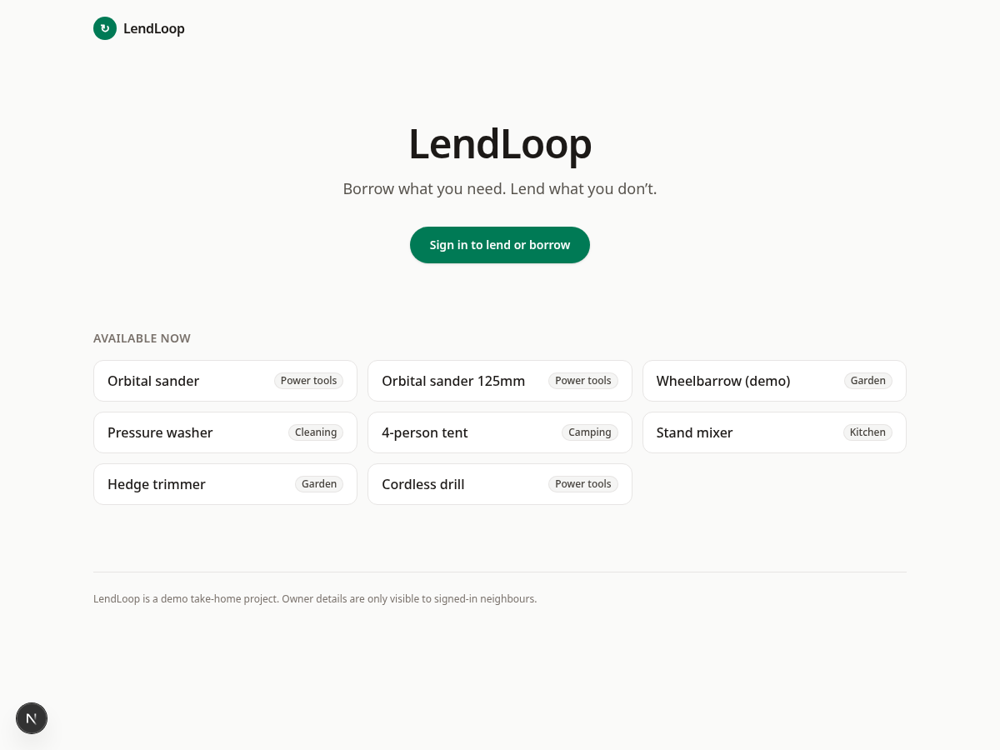
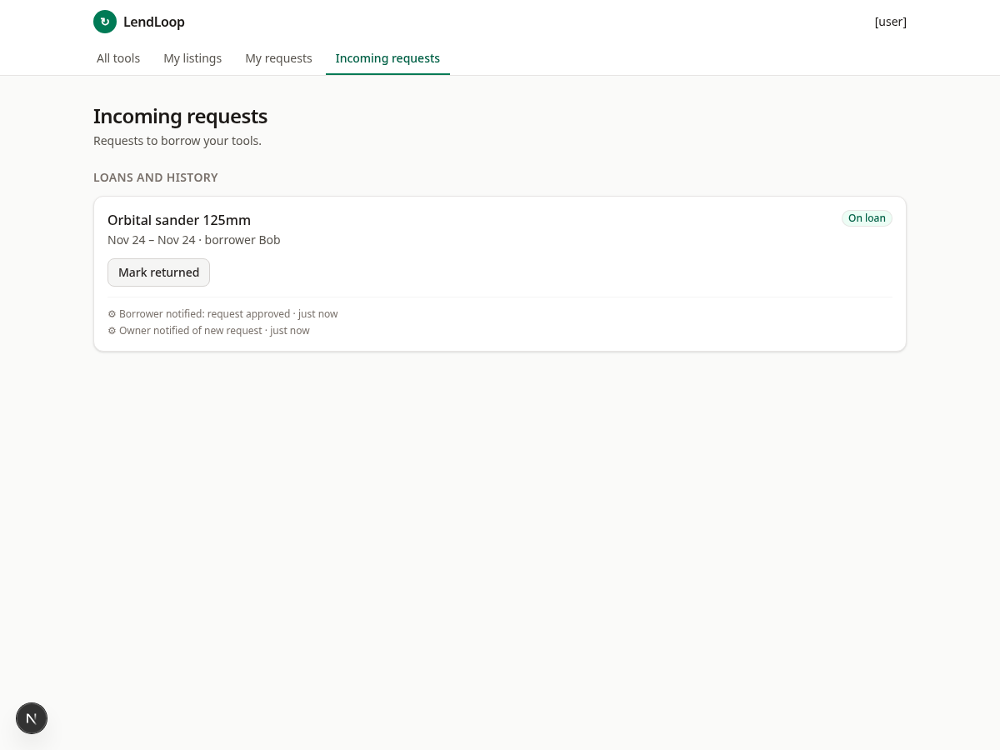
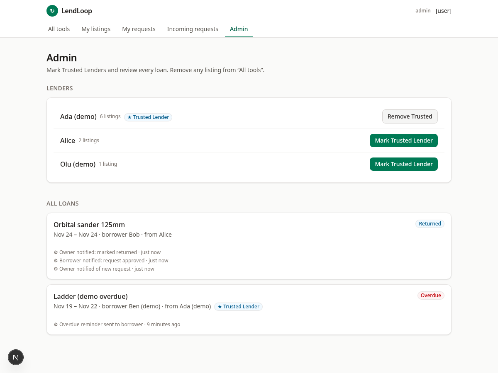
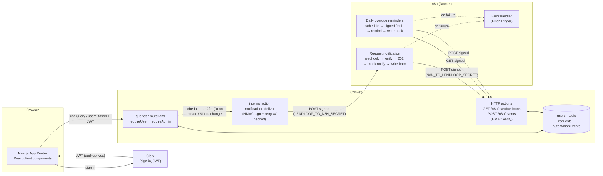
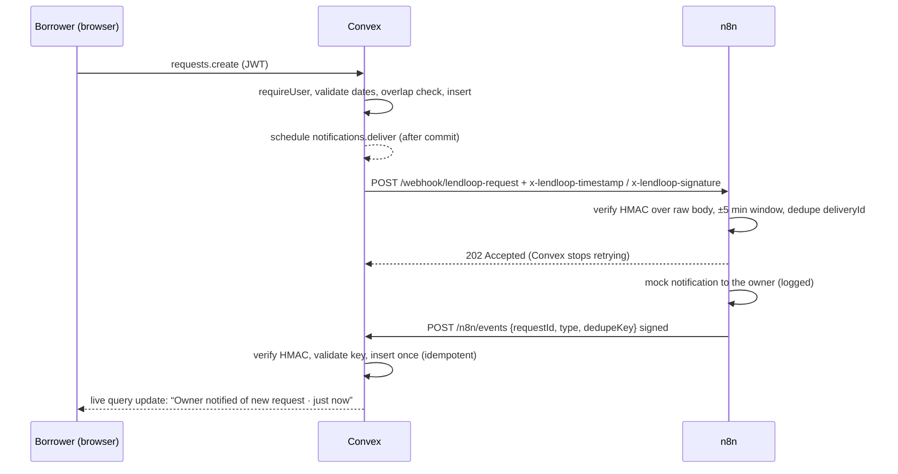

# LendLoop

**Borrow what you need. Lend what you don’t.**

A neighbourhood tool-lending board: neighbours list tools, request to borrow them for a date range, and get notifications and overdue reminders delivered by **n8n**. Built for the Fluence International Full-Stack Developer take-home.

**Stack:** Next.js 16 (App Router) · Clerk (auth) · Convex (data + backend logic) · n8n (self-hosted via Docker) · TypeScript · Tailwind CSS · Vitest.

> Built with AI assistance, as the listing allows.

| Public page | Incoming requests (with automation activity) | Admin |
| --- | --- | --- |
|  |  |  |

<sub>Screenshots from a local run against a local Convex backend and real n8n 2.49 workflows. In the signed-in shots the Clerk avatar shows as “[user]” because they were taken with a stand-in identity provider instead of a Clerk account.</sub>

---

## Contents

1. [Features](#features)
2. [Architecture](#architecture)
3. [Local setup](#local-setup)
4. [Environment variables](#environment-variables)
5. [Making an admin](#making-an-admin)
6. [n8n workflows](#n8n-workflows)
7. [Security and data-minimisation decisions](#security-and-data-minimisation-decisions)
8. [Testing and verification](#testing-and-verification)
9. [Project layout](#project-layout)
10. [Production](#production)

---

## Features

**Public (signed out)** — `/`
- LendLoop name and tagline.
- Read-only list of tools available today: **name and category only**, from Convex, with no owner details. The page renders on the server (`preloadQuery`) and then stays live.
- A **“Sign in to lend or borrow”** button that opens Clerk sign-in.

**Signed in**
- **All tools** (`/tools`): every listing with an *Available* or *On loan* badge, condition, description, the lender’s display name and a **Trusted Lender** badge, booked date ranges, and a category filter. *Request to borrow* opens a date-range form.
- **My listings** (`/my-listings`): create, edit and delete your own tools (name, category, condition, short description).
- **My requests** (`/my-requests`): what you asked to borrow, its status, and *Mark returned* while it is on loan.
- **Incoming requests** (`/incoming`): requests on your tools. *Approve*, *Decline*, and *Mark returned*.
- **Automation activity on every loan** (bonus), e.g. “⚙ Overdue reminder sent to borrower · 2 days ago”, “⚙ Borrower notified: request approved · just now”, or “⚠ Notification could not be delivered”.
- **Admin** (`/admin`, admins only): mark or unmark **Trusted Lender**, view **all loans**. Admins also get a *Remove listing* button on every tool in *All tools*.

**Rules (enforced in Convex)**

| Rule | Where |
| --- | --- |
| A tool is **unavailable** while it is out: an approved, unreturned loan that has started. That includes an overdue loan that has ended but was never marked returned. Pending requests don’t block. | `convex/lib/rules.ts` `isToolAvailable` |
| You can’t approve a request that **overlaps another approved loan** on the same tool. New requests that overlap an approved loan are rejected too. | `conflictsWithApprovedLoan` |
| Dates are real `YYYY-MM-DD` UTC days. Start date today or later, end on or after start, at most 60 days long, at most 1 year ahead. | `validateBorrowRange` |
| Status only moves `pending → approved/declined` and `approved → returned`. | `canTransition` |
| You can’t borrow your own tool or send a second overlapping pending request. | `requests.create` |
| An owner can’t delete a tool that is on loan. An admin can remove it for moderation. Removal is a soft delete, and pending requests on it are declined (with a notification). | `tools.remove` |

---

## Architecture

**Convex owns the data and every rule. n8n only delivers.** n8n never touches the database and never decides whether something is allowed. It gets a signed event and reports back what it did through a signed, idempotent endpoint.



**Request lifecycle → notification**



**Data model** (`convex/schema.ts`)

| Table | Purpose | Notes |
| --- | --- | --- |
| `users` | One row per Clerk identity (`tokenIdentifier`) | `role: "user" \| "admin"` (default `user`, never set from the client), `trustedLender`, `email` used only for notifications |
| `tools` | Listings | `ownerId`, `category`, `condition`, soft-delete `removedAt` / `removedBy` |
| `requests` | Requests and loans (a request becomes a loan when approved) | `status`, `startDate` / `endDate` (`YYYY-MM-DD` UTC), `ownerId` denormalised for the *Incoming* index |
| `automationEvents` | Audit trail plus idempotency ledger for n8n write-backs | unique `dedupeKey`, server-generated `message` |

**Signature scheme** (`convex/lib/hmac.ts`): `x-lendloop-signature: sha256=HMAC_SHA256(secret, "${timestamp}.${METHOD}.${path}.${rawBody}")` plus `x-lendloop-timestamp` (unix seconds). Signing the method and path means a signature captured for one endpoint can’t be replayed against another. There is one secret per direction.

---

## Local setup

**Prerequisites:** Node.js 20.9+ (tested on 24), npm, Docker (for n8n), a free [Clerk](https://dashboard.clerk.com) account and a free [Convex](https://dashboard.convex.dev) account.

### 1. Install

```bash
git clone https://github.com/PrinceGOdsplan/lendloop.git
cd lendloop
npm install
cp .env.example .env.local
```

### 2. Clerk

1. Create a Clerk application (email sign-in is enough).
2. In the Clerk Dashboard, open the **Convex integration** setup and click **Activate Convex integration**. Copy the **Frontend API URL**, e.g. `https://verb-noun-00.clerk.accounts.dev`.
3. On the **Sessions** page, in the **Claims** section (the `aud: convex` claim is already mapped), add the claims LendLoop reads (so Convex gets a display name and a notification email):
   ```json
   { "name": "{{user.full_name}}", "email": "{{user.primary_email_address}}" }
   ```
4. In **API keys**, copy the publishable key and secret key into `.env.local` as `NEXT_PUBLIC_CLERK_PUBLISHABLE_KEY` and `CLERK_SECRET_KEY`.

### 3. Convex

```bash
npx convex dev            # log in, create a project; writes CONVEX_DEPLOYMENT + NEXT_PUBLIC_CONVEX_URL to .env.local
```

Keep it running. It pushes functions and regenerates `convex/_generated` on every change. In a second terminal, set the backend environment variables (generate secrets with `openssl rand -hex 32`):

```bash
npx convex env set CLERK_JWT_ISSUER_DOMAIN https://verb-noun-00.clerk.accounts.dev
npx convex env set LENDLOOP_TO_N8N_SECRET <secret-A>
npx convex env set N8N_TO_LENDLOOP_SECRET <secret-B>
npx convex env set N8N_REQUEST_WEBHOOK_URL https://<your-n8n-host>/webhook/lendloop-request
npx convex env set LENDLOOP_ALLOW_SEED true     # dev only, enables the seed helpers below
npx convex run seed:demo                         # optional: a few demo tools for the public page
```

> **About `convex/_generated`:** these files are committed (Convex recommends this) so the repo typechecks, lints, tests and builds with no Convex account. They were produced by the real Convex CLI (`npx convex dev --once` in its account-less local mode, `CONVEX_AGENT_MODE=anonymous`), not written by hand. `npx convex dev` regenerates them against your deployment.

### 4. Run the app

```bash
npm run dev               # http://localhost:3000
```

Sign up with two different accounts (e.g. a normal and a private browser window) to try lending and borrowing between neighbours.

### 5. n8n (self-hosted, Docker)

```bash
cp n8n/.env.example n8n/.env      # fill in: N8N_ENCRYPTION_KEY, LENDLOOP_CONVEX_SITE_URL, both secrets
docker compose --profile setup run --rm n8n-import   # imports + publishes the 3 workflows
docker compose up -d n8n                             # editor: http://localhost:5678 (create the owner account)
```

- `LENDLOOP_CONVEX_SITE_URL` is your deployment’s **HTTP Actions URL**, ending in `.convex.site` (not `.convex.cloud`). Find it in the Convex dashboard under *Settings → URL & Deploy Key*.
- **Convex Cloud must be able to reach your n8n webhook.** For local n8n, expose port 5678 with a tunnel (e.g. `cloudflared tunnel --url http://localhost:5678` or `ngrok http 5678`). Then set `N8N_REQUEST_WEBHOOK_URL` to `https://<tunnel-host>/webhook/lendloop-request` and `WEBHOOK_URL` in `n8n/.env` to the tunnel URL. The other direction (n8n → Convex) needs nothing, because `.convex.site` is public HTTPS.
- To try the overdue flow without waiting days: `npx convex run seed:overdueLoan`, then open *LendLoop – Daily overdue reminders* in n8n and click **Execute workflow**. Run it twice: the second run finds nothing to remind, and the loan shows a single “Overdue reminder sent” entry.

---

## Environment variables

Templates with placeholders only: `.env.example`, `.env.convex.example`, `n8n/.env.example`. Real values live in `.env.local`, the Convex dashboard, and `n8n/.env`, all of which are git-ignored or outside the repo.

| Variable | Where it is set | Purpose |
| --- | --- | --- |
| `NEXT_PUBLIC_CLERK_PUBLISHABLE_KEY` | `.env.local` / host | Clerk frontend key (public) |
| `CLERK_SECRET_KEY` | `.env.local` / host | Clerk server key (used by `proxy.ts` route protection) |
| `CONVEX_DEPLOYMENT` | `.env.local` (written by `convex dev`) | Which deployment the CLI targets |
| `NEXT_PUBLIC_CONVEX_URL` | `.env.local` / host | Convex client URL (`*.convex.cloud`) |
| `CLERK_JWT_ISSUER_DOMAIN` | Convex env | Clerk Frontend API URL; Convex verifies JWTs against it (`convex/auth.config.ts`) |
| `N8N_REQUEST_WEBHOOK_URL` | Convex env | n8n production webhook URL for request events |
| `LENDLOOP_TO_N8N_SECRET` | Convex env **and** `n8n/.env` | Convex signs outgoing webhooks, n8n verifies |
| `N8N_TO_LENDLOOP_SECRET` | Convex env **and** `n8n/.env` | n8n signs calls to Convex HTTP endpoints, Convex verifies |
| `LENDLOOP_ALLOW_SEED` | Convex env (dev only) | Enables the internal `seed:*` helpers; leave unset in production |
| `N8N_ENCRYPTION_KEY` | `n8n/.env` | Encrypts n8n’s stored credentials |
| `WEBHOOK_URL` | `n8n/.env` | n8n’s public base URL |
| `LENDLOOP_CONVEX_SITE_URL` | `n8n/.env` | Convex HTTP Actions base URL (`*.convex.site`) |
| `GENERIC_TIMEZONE` | `n8n/.env` | Timezone for the daily 08:00 schedule |

If the webhook URL or secret is missing (for example on the public demo), nothing breaks. Borrowing works normally, Convex logs that it skipped the notification, and the loan shows a neutral “ⓘ Notification not sent: automation isn’t configured on this deployment”. If `N8N_TO_LENDLOOP_SECRET` is missing, the HTTP endpoints **fail closed** with a 503.

---

## Making an admin

There is deliberately **no** “make me admin” button or public mutation. `users.store` always creates `role: "user"` and never accepts a role from the client. Use either manual method once the person has signed in at least once:

- **Convex dashboard:** *Data → users*, find the row, and edit `role` from `"user"` to `"admin"`.
- **CLI** (calls an *internal* mutation that browsers can’t reach):
  ```bash
  npx convex run users:setRole '{"email":"you@example.com","role":"admin"}'
  ```

The role is read from the database on every admin query and mutation (`requireAdmin` in `convex/lib/auth.ts`), so it takes effect immediately and can’t be faked from the browser. Hiding the *Admin* tab is cosmetic only.

---

## n8n workflows

Exported, credential-free JSON in [`n8n/workflows/`](n8n/workflows):

| File | Trigger | What it does |
| --- | --- | --- |
| `lendloop-request-notification.json` | Webhook `POST /webhook/lendloop-request` (raw body) | Verifies the HMAC over the raw bytes, the ±5 min timestamp window, and a recent-`deliveryId` replay/duplicate cache. Rejects with 401, or returns **202** right away so Convex stops retrying. Then sends a **mock notification** (logged in the execution; swap in an Email or Slack node), then a **signed idempotent write-back** to `POST /n8n/events` (`dedupeKey = request:<id>:<event>`). |
| `lendloop-overdue-reminders.json` | Schedule, daily 08:00 (plus a manual trigger for testing) | Signed `GET /n8n/overdue-loans`, one item per loan, then a mock reminder to each borrower, then a signed write-back with `dedupeKey = reminder:<id>:<YYYY-MM-DD>`. Convex leaves out loans already reminded today, so a re-run on the same day sends nothing. |
| `lendloop-error-handler.json` | Error Trigger | Set as the error workflow of both workflows above. Logs workflow, execution URL, failed node and message, but no payloads. Add an Email or Slack node here for real alerting. |

**Reliability**
- Every HTTP Request node retries (4 tries, 3 s apart). After the last try the execution fails, and the error workflow runs, so it is visible in n8n’s *Executions* list.
- Convex → n8n delivery retries with exponential backoff (30 s, 60 s, 120 s, 240 s). It retries only network errors, 408, 429 and 5xx, not 4xx. After the last attempt it records a visible `notification_failed` event on the loan and logs `console.error`.
- Write-backs are idempotent. `automationEvents.dedupeKey` is unique (checked inside a serializable Convex mutation), and duplicates return `200 {duplicate:true}`, so a retry doesn’t create a second record.
- Delivery is **at least once**. If n8n sends a reminder and then the write-back fails for good, the next run can remind again. The error workflow makes that visible. Exactly-once delivery would need a claim step before sending (see [PRODUCTION.md](PRODUCTION.md)).

**Secrets in n8n:** HMAC signing needs the shared secret inside a Code node, and n8n’s built-in credential types can’t compute an HMAC. So the secrets live in the **n8n host environment** (`n8n/.env`, read as `$env.*`), never in node parameters. `npm run check:workflows` fails if an export contains credentials, signatures, tokens, long hex strings or unexpected `$env` names.

---

## Security and data-minimisation decisions

**Authorization lives in Convex, not the UI**
- Every public query and mutation that touches private data calls `requireUser` / `requireAdmin` first (`convex/lib/auth.ts`). Ownership checks are small pure functions in `convex/lib/rules.ts` and are unit-tested.
- `ownerId` / `borrowerId` always come from the verified identity, never from arguments.
- Admin powers are scoped: admins can remove listings, see all loans and toggle Trusted Lender, but they **can’t** edit other people’s listings or approve on someone’s behalf.
- Everything n8n needs is an **internal** function exposed only through HMAC-verified HTTP actions. Seed helpers are internal *and* gated by `LENDLOOP_ALLOW_SEED`.
- `proxy.ts` (Next.js 16’s replacement for middleware) keeps signed-out visitors off app routes. It’s a convenience layer; Convex is the real gate.

**Data minimisation**
- The public query returns only `{ name, category }`: no ids, owner ids, names or descriptions. A test asserts the exact key set.
- Signed-in views show display names only. **Emails are never returned to other users**; they are used only inside the notification and reminder payloads.
- Admin views show names and counts, not emails.
- Request webhook payload: event, status, tool name, dates, and **only the recipient’s** name and email. The other party’s identity is never sent.
- Overdue payload: borrower name, email, tool and due date. No owner data.
- n8n writes back only `{requestId, type, dedupeKey, recipientRole}` (a strict schema; unknown fields are rejected with a 400). **Convex writes the activity text itself**, so a buggy or compromised workflow can’t inject content into the UI.
- n8n execution data contains recipient emails, so the compose file prunes executions after 7 days, and the error handler logs metadata only.

**Integration security**
- HMAC-SHA256 in both directions, with **separate secrets** per direction and a constant-time compare. A ±5 min timestamp window gives replay protection, and method and path are bound into the signature. n8n verifies over the **raw** request body, not re-serialised JSON. Missing secrets fail closed.
- Inputs are bounded: 8 KB body limit on the write-back endpoint, length limits on tool fields, and enum validators for categories and statuses.
- Secrets live only in env (`.env.local`, Convex env, `n8n/.env`). `.gitignore` excludes every `.env*` except the `*.example` templates.
- Baseline HTTP security headers (`nosniff`, `DENY` framing, a strict referrer policy, a locked-down permissions policy), and `X-Powered-By` is off.
- n8n is bound to `127.0.0.1` in the compose file. Expose it only through a TLS reverse proxy or tunnel.

---

## Testing and verification

```bash
npm run verify            # typecheck + lint + unit tests + workflow export checks
npm run build             # production build (needs the NEXT_PUBLIC_* vars; dummy values work for a build)
```

- `tests/hmac.test.ts`: an RFC 4231 test vector, round trip, tampered body, wrong secret, method/path replay, stale/future timestamps, malformed headers, fail-closed behaviour.
- `tests/rules.test.ts`: availability (including overdue), overlap, date validation, the ownership and role rules, the status state machine, dedupe-key validation, retry/backoff policy.
- `tests/convex.test.ts` (with [`convex-test`](https://docs.convex.dev/testing/convex-test)): the real Convex functions with mocked identities. It covers anonymous access being rejected, the public query exposing only name and category, owner-only edit and delete, who may approve, decline or return, overlap blocking, normal users failing every admin function, admins’ powers, `setRole` being internal, HTTP endpoints rejecting unsigned, wrongly signed and stale calls (and returning 503 without a secret), idempotent write-backs, the minimal outgoing payload, and a signed delivery recording a visible failure.

The full loop was also exercised locally (see the PR description): a local Convex backend plus n8n 2.49 running these exact workflow files, covering Convex retrying until n8n was up, signature rejection, duplicate suppression, the error workflow firing, and overdue reminders idempotent across two runs.

---

## Project layout

```
app/                    Next.js routes: / (public) and (app)/ signed-in pages
components/             UI (AppShell syncs the Clerk user into Convex; RequestCard shows activity)
convex/
  schema.ts             tables + indexes
  lib/rules.ts          pure business + authorization rules (unit-tested)
  lib/hmac.ts           sign / verify (Web Crypto; runs in Convex, Node and tests)
  lib/auth.ts           requireUser / requireAdmin
  lib/automation.ts     dedupe keys, activity messages, retry policy
  tools.ts requests.ts admin.ts users.ts
  notifications.ts      signed webhook delivery with retries
  automation.ts http.ts n8n-facing internal functions + HMAC-verified HTTP routes
  seed.ts               dev-only internal helpers
n8n/workflows/          exported workflow JSON (no credentials)
docker-compose.yml      self-hosted n8n + one-shot importer
proxy.ts                Clerk route protection (Next.js 16 “proxy”, formerly middleware)
tests/                  Vitest suites
scripts/check-workflows.mjs
```

## Production

See [PRODUCTION.md](PRODUCTION.md) for what I would change before running this for real, and [docs/DEPLOY.md](docs/DEPLOY.md) for the live demo setup (Vercel + Convex).
